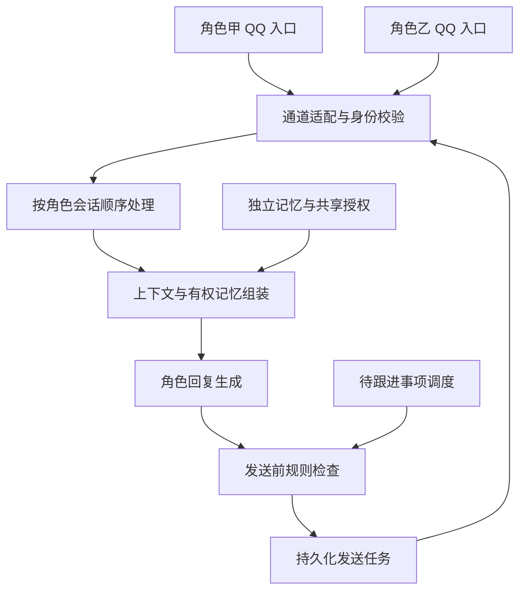

# 虚拟女友项目 GitHub 技术调研报告

**调研日期：2026-11-17；QQ 补充调研与决策更新：2026-11-18**  
**依据：**当前项目《虚拟陪伴产品需求说明书》v1.5（QQ 优先测试版）及 Excel 阶段看板 M0–M8。  
**性质：**公开仓库、官方文档和关键源码的桌面调研，未部署候选系统、未登录 QQ 或微信账号、未实测模型。本文中的架构、测试阈值和选型顺序是建议，不代表已经实现或验证通过。

## 1. 结论与建议

推荐采用 **QQ 官方机器人优先测试 + 可替换通道 + 独立陪伴业务内核 + 本地权威数据**。用户已于 2026-11-18 确认优先用 QQ 测试；微信转为后续接入选项。本次调整实施顺序，不认定最终平台，不视为任何实测已通过。

1. **M1 先用 QQ 官方机器人与 AstrBot 验证。** 从单角色私聊开始，再确认两个独立机器人入口、真实投递、跨天主动消息、权限关闭与断线恢复。可创建数量、实际账号权限与稳定性仍需验证。[Q01–Q04]
2. **微信保留为后续验证路线。** Tencent/openclaw-weixin 与 AstrBot 个人微信适配器继续作为参考，但其双入口、context_token 和投递条件不阻塞首轮 QQ 测试；也不能由 QQ 测试结果推导微信可用。[S01–S04]
3. **宿主优先 AstrBot，业务语义由本项目掌握。** 角色身份、记忆授权、主动策略与完整导入导出仍需实现。CowAgent 仅为宿主备选，切换前重新核实 QQ 适配能力；不同时引入两个宿主。[S05–S06、Q02]
4. **SQLite 保存权威数据，Mem0 为可选组件。** 人设体验参考 OpenCompanion、xiyuai 和 SillyTavern；不让某个框架的标签替代隔离、纠错和迁移验收。[S07–S11]
5. **QQ 官方接入优先于普通 QQ 号自动化。** 本轮不把 NapCat 等第三方个人号路线当成默认方案；其维护状态需重新核对。KouriChat 的腾讯系限制同时影响 QQ 与微信候选资格。[Q06、S14]

只做文字收发时，QQ 与微信 iLink 都有现成接入方式；QQ 当前公开的主动发送规则与独立机器人身份更便于设计本项目的首轮验证。这是工程选型判断，不是性能或稳定性实测结论。

## 2. 项目现状与调研边界

初次调研读取 PRD v1.4 和阶段看板；本次已同步至 QQ 优先测试版 v1.5。调研开始时目录中只有这两份业务文件，未发现业务实现；看板 M0–M8 均为“待开始”。因此本报告是实施前选型，不是现有代码审计。

| 已确定需求 | 技术影响 |
| --- | --- |
| 单个成年用户，首轮优先 QQ 文字测试 | 不为多用户平台、语音或 Live2D 增加前置成本 |
| 每个角色独立 QQ 机器人入口；微信后续验证 | 通道身份与角色固定绑定，不能只按用户 ID 路由 |
| 长期连续感，记忆可纠正 | 事实需要来源、时间、状态和版本，不能只存摘要 |
| 私有记忆默认隔离，共享须明确授权 | 检索前落实权限，共享事实与共同经历分开保存 |
| 主动联系默认关闭，可暂停、不打扰 | 授权、静默、限额与平台条件由确定性逻辑控制 |
| 完整角色资料可导入导出 | 自有、版本化的数据包协议属于首版能力 |
| 管理界面不重要 | 可以先用配置文件和有限聊天指令 |
| 只安排阶段，不排时间 | 沿用 M0–M8，以退出条件推进，不编造工期 |

角色个人生活、默认主动节奏、删除后重新学习、关系发展细则、体验指标和管理界面仍是 PRD 待考虑问题。本报告相关建议仅用于实验，未擅自将其定为产品规则。

“本地保存”不等于“完全离线”。调用云端模型或向量 API 时，提交内容仍会进入相应服务。当前没有硬件规格、模型预算或必须离线的明确条件，因此暂不指定模型尺寸和硬件购买方案。

## 3. 方法与证据强度

围绕微信接入、机器人宿主、陪伴行为、人设与记忆，初次比较 **11 个项目方向、12 个 GitHub 仓库地址**，本次补充 QQ 官方文档、SDK 与接入状态核查。Letta 同时核查旧入口和当前源码仓库。优先使用仓库维护者的 README、源码、文档和发布说明。

| 证据 | 本次已做 | 不能据此断言 |
| --- | --- | --- |
| 文档证据 | 确认定位、公开能力及限制 | 实际账号可用、长期稳定 |
| 源码证据 | 查看 AstrBot 微信发送分支、Mem0 作用域处理 | 完整系统不存在其他缺陷 |
| Issue 线索 | 核查投递异常报告及后续恢复 | 平台普遍故障或固定限制 |
| 本报告建议 | 架构、自研边界、POC 与退出条件 | 已经实现或测试通过 |

**版本限制：**本次主要查看默认分支与当日可访问页面，未对所有仓库固定 commit SHA，也未完成全量源码审计。默认分支可能领先发行版，检索缓存可能滞后。因此不提供未经核实的最新稳定版、精确提交时间或性能排名。M1 实验必须记录 SHA、包版本、客户端版本、模型 ID 和配置摘要。

## 4. 候选项目对比

“未证实”表示证据不足，不等于项目必然不支持。许可证记录页面标识和用途声明，具体版本须复核 LICENSE。

| 项目 | 观察到的定位/能力 | 对本项目的缺口 | 版本与许可注意 | 建议 |
| --- | --- | --- | --- | --- |
| [tencent-connect/qqbot-nodejs](https://github.com/tencent-connect/qqbot-nodejs) | QQ 官方组织 SDK，WebSocket、消息与主动发送接口 | 账号权限、双入口和真实投递需测；Python 宿主不必另引入 Node 服务 | 当前文档与锁定版本分别核对 | QQ 通道参考 [Q03] |
| [Tencent/openclaw-weixin](https://github.com/Tencent/openclaw-weixin) | 扫码、长轮询、消息收发、多账号通道 | 多账号不自动证明同一用户拥有两个合适的角色入口；不含陪伴业务 | README 标 MIT，出现 3.0.0-beta-0 说明，不能当作已验证稳定版 | 微信后续验证 [S01–S02] |
| [AstrBotDevs/AstrBot](https://github.com/AstrBotDevs/AstrBot) | IM、模型、人设、插件及个人微信适配 | 共享撤销、权限、资料包需应用层补齐 | AGPL-3.0；文档称个人微信适配器从 v4.22.0 引入 | 首选 POC 宿主 [S03–S05] |
| [zhayujie/CowAgent](https://github.com/zhayujie/CowAgent) | 原 chatgpt-on-wechat，现为通用助手与 Agent 宿主 | 工具面超出首版，需核实角色隔离并收敛能力 | MIT；旧链接跳转，不能直接套用旧教程 | 备选宿主 [S06] |
| [Nekoluna-dot/OpenCompanion](https://github.com/Nekoluna-dot/OpenCompanion) | Python 陪伴、iLink、记忆与主动插件 | 双角色权限与完整迁移未证实；追催倾向须按 PRD 调整 | AGPL-3.0；本次未测运行质量 | 陪伴对照样本 [S07] |
| [xiyuailove/xiyuai](https://github.com/xiyuailove/xiyuai) | Node.js、SQLite、微信、分层记忆和主动策略 | 多角色授权、迁移及长期运行仍需核对 | MIT；行为描述主要来自 README，未完成关键模块审计 | 参考策略与轻量结构 [S08] |
| [SillyTavern/SillyTavern](https://github.com/SillyTavern/SillyTavern) | 角色扮演前端与角色定义体系 | 不是现成微信业务后端，完整关系迁移需另做 | AGPL-3.0 | 人设和模型对照 [S09] |
| [mem0ai/mem0](https://github.com/mem0ai/mem0) | 记忆提取/检索及作用域参数 | 共享授权、事件状态和来源级删除是应用职责 | Apache-2.0；过滤 API 需按固定版本核对 | 可选组件 [S10–S11] |
| [letta-ai/letta](https://github.com/letta-ai/letta) / [letta-code](https://github.com/letta-ai/letta-code) | 有状态 Agent 与记忆；旧入口指向新源码 | 需要重评当前运行时，首版暂不需完整自主 Agent 宿主 | 页面标 Apache-2.0；旧 V1 server 位于 archive | 暂不引入 [S12–S13] |
| [KouriChat/KouriChat](https://github.com/KouriChat/KouriChat) | 情感陪伴、持久记忆与人设 | 明确禁止接入腾讯系软件，与微信要求冲突 | 重构版本不能混用旧版能力说明 | 排除 QQ / 微信实现 [S14] |
| [lich0821/WeChatFerry](https://github.com/lich0821/WeChatFerry) | Windows 微信 Hook 与多语言客户端 | 强依赖客户端适配与运行环境 | MIT；README 记录 3.9.12.51 等版本，不证明兼容任意新版 | 受控备选 [S15] |
| [cluic/wxauto](https://github.com/cluic/wxauto) | Windows UIAutomation 收发消息 | UI 状态、多实例、锁屏、断线需实测 | README 标微信 3.9.X，声明限制生产/商业用途 | 非默认基座 [S16] |

### 4.1 维护状况与版本漂移

AstrBot 可查到适配文档、源码与发布记录，适合先进行集成验证，但不等于长期稳定已经得到证明。CowAgent 和 Letta 的迁移说明要求跟随当前维护入口。KouriChat 的重构发布说明提到主动消息和定时任务等能力尚待回归，不能将旧版演示与新版本视为同一套能力。[S05、S06、S12、S14]

OpenCompanion 与 xiyuai 体验方向接近，但本次没有充分的长期运行与维护证据。可投入有限的阅读和对照成本，暂不让它们决定整个项目的数据格式。Stars、截图与宣传文案不作为成熟度评分。

### 4.2 自研、复用与 Fork 的选择

优先使用插件或薄适配层复用通道与模型能力，陪伴内核保持独立。POC 若证明宿主生命周期妨碍顺序处理、事务一致性或完整导出，再考虑独立服务或局部 Fork。首版不同时引入两个通用宿主，避免维护两套会话和记忆。

核心成本集中在“谁知道什么”“纠错是否彻底生效”“何时可以主动联系”“迁移后是否接续”。框架的多 Agent、长期记忆或定时任务标签不能替代这些产品语义。

## 5. QQ 优先接入与 M1 验证

### 5.1 接入顺序与难度差异

| 路线 | 当前用途 | 主要待验证项 |
| --- | --- | --- |
| QQ 官方机器人 + AstrBot WebSocket | 首轮首选 | 应用创建、单聊权限、两个独立入口、主动投递和重连 |
| QQ 官方 SDK / 薄适配层 | 核查协议与宿主备选实现 | 不同 SDK 与固定版本能力；不为使用 SDK 而改变业务语言 |
| 微信 iLink + AstrBot | 后续通道验证 | ClawBot 准入、可辨识双入口、会话 token 和投递条件 |
| 公众号 / 企业微信 | 仅在接受相应入口体验后评估 | 账号条件与角色入口体验 |
| 个人号 Hook / UI 自动化 | 非首轮默认方案 | 当前维护状态、客户端适配、账号及无人值守条件 |

QQ 当前 AstrBot 文档提供扫码创建机器人和 WebSocket 接入。微信提供扫码登录与长轮询，不要求公网 Webhook。两者基础文字聊天都可复用适配器，不能简单断言微信必须控制桌面客户端。[Q02、Q05]

### 5.2 QQ 主动发送：按当前官方规则验证

当前 QQ 官方站点的消息概述区分普通主动消息、互动召回（`is_wakeup`）与携带 `msg_id` / `event_id` 的被动消息。用户可在客户端关闭主动发送权限。当前文档单聊被动回复有效期为 60 分钟、每条可回复 4 次；普通主动消息还受 Bot 与单用户频控约束。SDK 提供不带 `msgId` 的主动发送路径，但接口存在不等于当前账号必然获准或投递成功。[Q01、Q03]

旧 GitHub bot-docs 仍保留 2025 年停止主动推送及较旧回复次数说明，与当前官方站点有差异。本报告优先引用当前官方站点；M1 必须记录日期、适配器版本、应用权限和实际返回，不能把旧教程当作现行规则。普通主动消息与互动召回的额度不能混用。[Q01、Q04]

产品自己的低打扰上限与平台频控分开管理；不把平台上限设为角色默认频率。测试应覆盖长空闲后主动联系、平台权限关闭、频控拒绝和产品暂停；被动回复成功不能替代主动投递证据。收到平台拒绝后不要通过其他消息类型反复尝试绕过。

### 5.3 微信后续核查项

腾讯协议建议回复时回传入站 `context_token`，并说明客户端缺 token 时尝试发送不能证明服务端接受。AstrBot 已读发送分支缺少 token 时直接跳过。微信主动联系并非已被证明不可用，但需要验证当前会话凭证和实际投递，不能沿用 QQ 规则，也不预设固定 48 小时窗口。[S02、S04]

Issue #371 曾报告 `ret=0` 但客户端不可见，作者后补充当日自行恢复、原因未确认；只作为端到端检查线索，不作为普遍故障结论。[S17]

### 5.4 首轮 QQ POC 与退出条件

1. 创建一个官方机器人，完成与本用户的真实私聊，记录应用身份、权限、版本和客户端结果。
2. 创建第二个独立机器人并固定映射角色甲、乙；分别聊天、交错发消息，检查身份、人设、历史、记忆与回复归属。创建数量或权限不满足时保持双入口验证未通过。
3. 用户授权后测试有理由的主动消息，包含空闲跨天场景；同时验证产品暂停、安静时段及 QQ 客户端关闭主动消息权限。
4. 重启与断网恢复，检查身份绑定和凭据恢复；不要补发过期问候。
5. 测试重复事件、回复次数限制、发送超时与发送后崩溃，记录 accepted / rejected / unknown，不把 HTTP 200 直接等同于用户可见。
6. 单角色、双入口、主动边界与恢复分别留证，满足首轮目标才通过 M1；模拟通道不替代真实 QQ 验证。微信不阻塞本轮，但仍保留自己的待验证状态。

## 6. PRD 覆盖与自研边界

| 能力 | 可复用基础 | 必须补齐/验证 | PRD 验收 |
| --- | --- | --- | --- |
| 收发与模型 | 通道、Provider | 身份绑定、顺序、短句合并、幂等 | 1、7、9 |
| 人设与自然表达 | 人设配置、SillyTavern 对照 | 场景集、用户偏好优先、版本生效 | 2、13、14 |
| 长期记忆和纠错 | Mem0 可选提取/召回 | 来源、状态、冲突、删除后防复现 | 3、4、8 |
| 私有与共享 | 数据库、作用域过滤 | 显式授权、撤销、衍生记录与冲突 | 15、16、17 |
| 主动联系 | 通道发送、定时唤醒 | 默认关闭、静默、退避、总量和过期 | 5、6、14 |
| 完整迁移 | 文件和数据库 | 版本包协议、原子导入、默认副本 | 10、11、12、17 |

本次没有整套验收已实现的证据，因此不虚构“需求完成百分比”。

## 7. 推荐架构与可靠性

以下是本报告的拟议设计，在 M2 根据 POC 修订。首版建议 Python 单服务、SQLite 事务存储，模型通过独立 Provider 调用。人设和管理先使用本地配置与有限聊天指令。

共享的是处理代码，角色私有数据保持隔离。程序固定入口与角色的映射，不让模型自行决定当前身份。

| 模块 | 责任 |
| --- | --- |
| ChannelAdapter | 接收、发出、连接状态与发送能力，提供模拟实现 |
| ConversationService | 去重、短句合并、顺序处理和回复生成 |
| PersonaService | 人设、互动习惯、用户边界与版本 |
| MemoryService | 来源、确认、纠错、权限和召回 |
| FollowupService | 事项到期、候选、冷却、退避与发送资格 |
| CharacterPackageService | 完整包、模板、原子导入和版本迁移 |
| ModelProvider | 对话和结构化提取，分别记录时延/token |

建议会话键为 `(owner_id, character_id, platform, channel_account_id, peer_id)`；入站幂等键包含通道账号和消息 ID。QQ 将应用身份与用户 openid 一并保存，不把不同应用或平台的用户标识默认视为同一值；用户本人由受控绑定映射到 owner_id。仅按 `user_id` 归档会混合用户对不同角色的表达。

短句合并设置有限时间窗、最大等待时间和条数，防止持续输入导致永不回复，具体参数在 M3 测试。同角色会话串行，不同角色可并发。

回复先写入持久化 Outbox，再提交通道，记录尝试次数和结果。若没有可靠回执或通道幂等保证，可能发生“已送达但未记账”后崩溃；不能承诺严格只发送一次。不确定时不要盲目自动重发，保留核对和下次交互恢复路径。

首版不把 Supervisor 多 Agent、队列集群、图数据库或微调作为前置条件。需要独立向量服务时，以真实数据量和召回实验为依据。

## 8. 记忆与共享授权

### 8.1 数据对象建议

| 对象 | 关键字段/关系 | 目的 |
| --- | --- | --- |
| Character | character_id、persona_version、settings_version | 身份稳定和配置版本 |
| ChannelBinding | account_id、peer_id、character_id | 入口不串角色 |
| Message | message_id、character_id、event_time、role | 原始证据和顺序 |
| Memory | kind、status、source_message_ids、valid_from/to、version | 当前/历史事实与推测分离 |
| SharedFact | fact_id、owner_id、content、version、consent_event | 明确授权的少量共享事实 |
| MemoryLineage | source_fact_id、derived_memory_id、derived_summary_id | 撤销与删除的来源追踪 |
| Followup | character_id、due_at、timezone、status、expires_at | 可取消的事项状态 |
| Outbox | message_key、character_id、status、attempts、expires_at | 发送恢复和不确定状态 |

### 8.2 写入与召回

从用户证据提取候选事实，校验类型和来源，判断新增、更新或冲突，必要时确认后事务写入权威库，再更新索引。角色编造、玩笑和未经确认推测不能直接成为用户事实。

召回前限定当前角色及有效共享授权，再筛相关性。不能先检索所有角色的私密信息、再用 Prompt 要求保密。近期上下文、摘要缓存与日志查询也要保持同一边界。

Mem0 源码提供 `user_id`、`agent_id`、`run_id` 的作用域处理。本次读取的分支区分了 `add()` 顶层参数与 `search()/get_all()` 的 `filters` 形式；使用时应按锁定版本验证，不能复制旧示例。[S11]

可将角色 ID 映射到受控作用域，但应用层必须强制补入条件，并校验返回记录归属。Mem0 能存取记忆，不等于它理解本项目的共享授权与撤销规则。

### 8.3 纠正、删除、撤销

“我现在不准备考研了”应结束旧计划并记录新状态，保留历史不代表旧计划仍有效。更正后应失效相关摘要和缓存。

撤销共享须覆盖共享查询、索引和衍生摘要。其他角色已在自己的聊天中谈过该内容，是否进一步删除独立记忆按 PRD 让用户选择。来源链可以定位衍生记录并说明影响范围。

只删向量而保留摘要会造成旧事实重新进入上下文。用户要求不再记住某类内容时，可考虑最小化的禁止再提取标记；保留策略和何时允许重新学习仍须在 PRD 待决项中确认。聊天平台客户端已有聊天展示与产品内删除分开说明。

## 9. 主动联系

采用“可以取消的候选”，不把到期事项变成必须发送的定时消息。发送前检查授权、暂停、时区与静默、角色限额、用户总量、事项有效性、主题冷却、未回复退避和平台发送条件。

模型生成后、真正提交前再检查一次，防止用户在生成期间刚好暂停。用户未回复时拉长间隔或停止联系。多角色共用用户级打扰预算，默认数值仍是待验证产品规则。

| 情况 | 建议行为 |
| --- | --- |
| 无线索且未允许日常问候 | 不创建发送任务 |
| 暂停、静默或超限 | 跳过机会，不积压问候 |
| 用户已告知结果 | 更新事项、取消候选 |
| 通道不允许发送 | 保留有效事项供下次聊天跟进 |
| 停机后恢复 | 日常问候过期作废，不集中补发 |
| 发送结果不确定 | 标记 unknown，避免循环补发 |

xiyuai 的主动与收敛策略可参考；OpenCompanion 的插件和提醒可参考，但其主动追催倾向不直接成为本项目默认行为。[S07–S08]

## 10. 完整角色资料迁移

SillyTavern 角色定义可参考人设字段，但本项目恢复的是关系资料，包括记忆、对话和设置。[S09]

| 拟议文件 | 内容 |
| --- | --- |
| manifest.json | schema_version、角色标识、导出时间、文件清单、校验值和导出类型 |
| persona.json / preferences.json | 人设、互动习惯、关系起点、称呼和边界 |
| memories.jsonl | 确认记忆、来源、状态和有效时间 |
| conversations.jsonl | 有序聊天及必要元数据 |
| followups.jsonl | 未过期事项和状态 |
| settings.json | 主动联系与静默设置，不含密钥 |
| shared_snapshot.json | 用户勾选的共享副本，说明原归属 |
| assets/ | 头像等附件 |

这是本报告提出的格式，不是已有通用标准。导入时先验证版本、清单、路径和完整性，在暂存区构造新角色、检查引用，再一次性提交。默认创建新 ID 的副本，重新确认聊天入口；替换已有角色须确认影响范围并提供备份。失败不改写现有资料。

共享副本导入后只供新角色使用，不写入全局 SharedFact。完整包排除 QQ AppSecret、平台 token、模型 Key 和其他角色资料。模板包排除私密聊天、记忆与共享副本。

## 11. 模型与成本验证

没有硬件、预算和真实数据，不从仓库截图决定最佳模型。M1 选择两个可用云端模型，并在硬件允许时加一个本地模型，用同一中文场景集比较，记录确切 ID、服务商、参数和日期。

覆盖闲聊、情绪分享、长分析、跨天面试、偏好纠正、虚构经历诱导、长上下文，以及两种性格对相同事件的反应。模型负责表达与提取，权限和发送资格由程序控制。

记录输入/输出 token、提取及摘要调用、向量化、响应耗时、失败和重试。日成本按“对话输入 + 对话输出 + 提取 + 摘要 + 向量化 + 重试”求和，使用实测量和当时价格换算，不编造月费或 GPU 性能。

优化优先采用有限上下文、按需召回、延后非必要提取。先测自然度与纠错，再决定是否微调。

## 12. POC 与验收建议

以下数值为建议的首轮门槛，不是已确认 PRD 指标或实测结果。隔离与权限零容忍失败；体验指标经过连续试用校准。

| 验证 | 最小实验 | 建议通过条件 | 不通过时 |
| --- | --- | --- | --- |
| 双入口 | 2 角色各 20 条，含交错和重启 | 40 条路由正确，无串线 | 阻断 QQ 双入口方案定稿 |
| 记忆隔离 | 20 组私有事实向另一角色追问 | 未共享泄露 0 次 | 修复检索/缓存边界 |
| 纠错撤销 | 20 组变更、冲突和撤销 | 旧错误不继续有效，撤销后不从共享源引用 | 查来源链和摘要 |
| 主动联系 | QQ 跨天实际投递、平台权限关闭；模拟静默、暂停、上限、退避、过期 | 获准消息客户端可见；产品禁止条件下 0 次出站，平台拒绝后无反复重试 | 修复规则与发送前复核 |
| 消息恢复 | 重复事件、超时、断线、发送后崩溃 | 不盲目补发，不确定状态可解释 | 修复幂等和 Outbox |
| 迁移 | 完整包、模板、共享副本和损坏包 | 恢复一致、损坏包不改写旧角色 | 修复 schema/事务 |
| 人设体验 | 至少 30 组场景、两性格和模型对照 | 人工记录差异、违和和重复，不预设虚假总分 | 调整人设/上下文 |
| 连续试用 | 建议先连续 7 天 | 无未解决阻断项，维护与恢复方法明确 | 延长试用并复验 |

静态核查、模拟测试与真实 QQ 测试分开记录。模拟通过不能抵消双入口失败。

## 13. M0–M8 阶段衔接

| 阶段 | 调研转成的任务 | 退出条件 |
| --- | --- | --- |
| M0 需求与验收定稿 | 确认入口体验、撤销范围与模型数据流 | 场景映射到 PRD 17 项，待决项留档 |
| M1 QQ 与模型验证 | 单角色→双入口、跨天主动与平台权限关闭、模型对照 | 客户端实际收发证据与可用条件明确 |
| M2 方案与工程准备 | 通道接口、会话键、schema、模拟入口 | 链路可重复运行，依赖锁定 |
| M3 QQ 聊天 | 顺序、短句、去重、人设版本 | 双角色并发与恢复通过 |
| M4 长期记忆 | 权威库、来源链、共享、纠错和删除 | 跨天接续、隔离和撤销通过 |
| M5 主动联系 | 默认关闭、时区、总量、退避、过期 | 禁止发送测试通过，无集中补发 |
| M6 迁移与恢复 | 完整包/模板、共享副本、原子导入 | 新环境恢复及损坏包保护通过 |
| M7 系统验收部署 | 覆盖 17 项，演练备份、回退、凭证和日志 | 阻断项清零，真实 QQ 与恢复留证 |
| M8 连续试用启用 | 收集自然度、错误和打扰反馈 | 复盘完成，维护和启用范围明确 |

M5 与 M6 在 M4 数据结构稳定后可交错推进。阶段依靠证据退出，不按日历自动推进。

## 14. 决策记录与未决项

| 决策 | 当前建议 | 改变建议的条件 |
| --- | --- | --- |
| 首轮测试通道 | QQ 官方机器人 + AstrBot，用户已确认优先测试 | 双入口、权限或真实投递不成立时重新评估 |
| 后续通道 | 微信 iLink 单独验证 | QQ 测试后，根据使用需求决定接入 |
| 宿主 | AstrBot 首选、CowAgent 备选 | 插件无法掌握顺序、数据和发送生命周期 |
| 记忆 | SQLite 权威数据，Mem0 可选 | 实验收益足以覆盖组件与运维成本 |
| 迁移 | 自有版本化包 | 出现满足完整语义的可扩展标准 |
| 模型 | 同场景对照后确定 | 实测自然度、纠错、成本或时延不达标 |
| 界面 | 配置与聊天指令 | 实际操作成本证明需要界面 |

需要进一步确认：QQ 机器人创建数量与账号权限、跨天主动发送条件、是否完全离线、机器规格和预算、撤销共享后的默认派生数据处理、多角色总打扰上限。前四项影响 M1/M2，后两项在对应功能定稿时确认。

推进顺序为：先证明双入口成立，再证明数据和规则可控，最后通过长期试用判断是否值得聊天。

## 15. 来源索引

S 系列来源于 2026-11-17 初次调研；Q 系列于 2026-11-18 补充核查。默认分支是可变引用，实施前应锁定 SHA。来源支持对应仓库事实，不为本报告的设计建议背书。

| 编号 | 来源 | 支持内容 |
| --- | --- | --- |
| S01 | [Tencent/openclaw-weixin](https://github.com/Tencent/openclaw-weixin) | 通道、多账号、依赖、许可标识 |
| S02 | [protocol.md](https://github.com/Tencent/openclaw-weixin/blob/main/docs/protocol.md) | context_token 与发送语义 |
| S03 | [AstrBot 个人微信文档](https://github.com/AstrBotDevs/AstrBot/wiki/en-platform-weixin_oc) | 适配器、扫码/长轮询、引入版本 |
| S04 | [AstrBot 微信适配源码](https://github.com/AstrBotDevs/AstrBot/blob/master/astrbot/core/platform/sources/weixin_oc/weixin_oc_adapter.py) | `_send_items_to_session`、身份和轮询 |
| S05 | [AstrBot 仓库](https://github.com/AstrBotDevs/AstrBot)；[Releases](https://github.com/AstrBotDevs/AstrBot/releases) | 定位、插件、人设与发布记录 |
| S06 | [CowAgent](https://github.com/zhayujie/CowAgent) | 改名、多通道、Agent 定位 |
| S07 | [OpenCompanion](https://github.com/Nekoluna-dot/OpenCompanion) | Python、PlatformAdapter、iLink 与主动插件 |
| S08 | [xiyuai README](https://github.com/xiyuailove/xiyuai/blob/main/README.md)；[仓库](https://github.com/xiyuailove/xiyuai) | Node/SQLite、主动/记忆文档描述、MIT 标识 |
| S09 | [SillyTavern](https://github.com/SillyTavern/SillyTavern)；[Character Design](https://docs.sillytavern.app/usage/core-concepts/characterdesign/) | 角色字段与上下文占用 |
| S10 | [Mem0](https://github.com/mem0ai/mem0) | 记忆组件定位与许可 |
| S11 | [Mem0 memory/main.py](https://github.com/mem0ai/mem0/blob/main/mem0/memory/main.py) | 作用域与 add/search 参数语义 |
| S12 | [Letta 旧入口](https://github.com/letta-ai/letta) | 迁移与 archive 说明 |
| S13 | [letta-code](https://github.com/letta-ai/letta-code) | 当前源码入口与许可标识 |
| S14 | [KouriChat](https://github.com/KouriChat/KouriChat)；[Releases](https://github.com/KouriChat/KouriChat/releases) | 腾讯系限制与重构说明 |
| S15 | [WeChatFerry](https://github.com/lich0821/WeChatFerry) | Windows Hook、客户端与适配版本 |
| S16 | [wxauto README](https://raw.githubusercontent.com/cluic/wxauto/master/README.md) | Windows/微信条件、用途声明 |
| S17 | [腾讯通道 Issue #371](https://github.com/Tencent/openclaw-weixin/issues/371) | 投递差异报告，含当日自行恢复更新 |

建议阅读顺序：先 Q01/Q02/Q03 的 QQ 接入、消息权限和恢复机制，再 S11 的作用域处理；随后阅读 S07 的适配层和插件接口，以及 S08 README 指向的主动/记忆模块，逐项对照 PRD。用 S09 进行人设对照；S02/S04 的身份、token 和发送失败分支留到微信接入验证时阅读。

本报告没有运行候选系统，不能用作生产可用、模型效果、账号稳定或全部许可义务已核验的保证。交付的是可追溯的选型依据和可执行的验证清单。

### QQ 优先测试补充来源

| 编号 | 来源 | 核查用途 |
| --- | --- | --- |
| Q01 | [QQ 官方消息收发概述](https://bot.q.qq.com/wiki/develop/api-v2/server-inter/message/overview.html) | 主动、召回、被动消息及当前频控与用户权限 |
| Q02 | [AstrBot QQ WebSocket 接入](https://docs.astrbot.app/platform/qqofficial/websockets.html) | 扫码创建、单聊、实例配置 |
| Q03 | [QQ 官方组织 Node.js SDK 使用指南](https://github.com/tencent-connect/qqbot-nodejs/blob/main/USAGE.md) | WebSocket 恢复、主动发送与流式接口 |
| Q04 | [旧 bot-docs 发送说明](https://github.com/tencent-connect/bot-docs/blob/main/docs/develop/api-v2/server-inter/message/send-receive/send.md) | 旧规则对照，不用作当前能力结论 |
| Q05 | [AstrBot 个人微信接入](https://docs.astrbot.app/platform/weixin_oc.html) | 微信扫码与长轮询接入条件 |
| Q06 | [NapCatQQ 当前仓库](https://github.com/NapNeko/NapCatQQ) | 核查时首页显示 Ending；不据旧教程认定维护可持续 |

## 16. 本次决策变更

2026-11-18 按用户决定改为 QQ 优先测试，同步 PRD v1.5 与阶段看板。核心 17 项验收不变；通道相关验收在 QQ 执行，微信后续独立验证。文档更新没有推进 M0–M8 的实际状态，也没有完成账号接入或实测。
