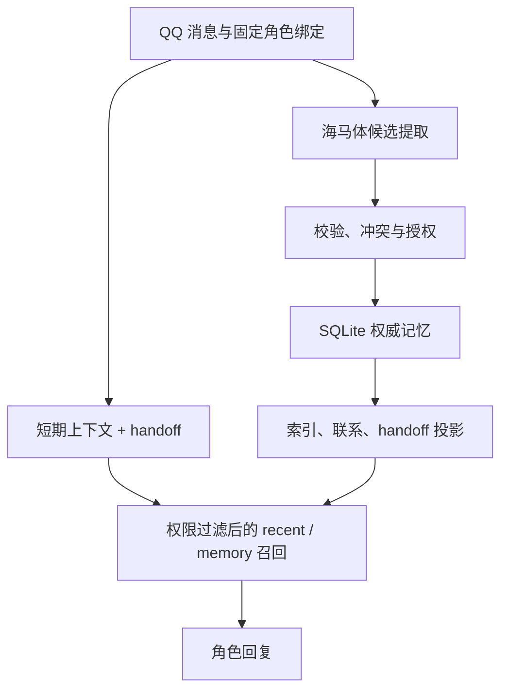

# 拟真记忆系统设计

**版本：** 0.3（补充鱼的记忆实现分析）  
**日期：** 2026-11-18  
**依据：**《虚拟陪伴产品需求说明书_QQ优先测试版_v1.5》、`research/虚拟女友_GitHub技术调研报告.md`，以及本次关于“主人格、遗忘、类人脑分层与联系强化”的讨论。  
**定位：** 记忆子系统的可实施方案及实验计划；尚无业务代码或长期使用数据，不将拟议机制写成已验证效果。

## 1. 先定义“同一条鱼”

模型每次生成都依赖这次提供的上下文。单一平台会话也会截断、压缩和转移注意力，不能天然保证连续的“个体”或“意识”。本项目不声称实现同一个体、持续意识或人脑机制；要实现的是**用户可感知的同一角色人格与共同关系连续性**。

人格连续性来自三个可追溯的部分：稳定但可修改的角色核心（思维取向、性格、表达和边界），与用户共同经历形成的状态，以及每次对话如何受这些资料约束并反过来更新它们。不同会话可以呈现角色的不同侧面；只要都从同一角色权威状态读取，合法的新经历也写回该状态，换会话或重启不应造成无故失忆、突然换人或跨角色串线。聊天平台中的“单一会话”只是入口，不是记忆架构的边界。

> **设计目标：** 相关时想起、说错后能改、该忘的确实不再使用；偶尔想不起低重要性细节时自然承认不确定。不能以“人会遗忘”为由忘掉明确约定、用户边界，或重新生成已删除的私密信息。

## 2. PRD 约束与设计决策

| PRD 要求 | 记忆设计的约束 |
| --- | --- |
| 一人多角色，每位角色一个 QQ 入口 | 入口固定绑定角色；私有消息、摘要、事件、联系、缓存、索引全按 `owner_id + character_id` 隔离。微信以后另验通道。 |
| 少量共享资料须逐项授权 | 共享事实单独存放；先做授权过滤，再做检索和关联扩展。共享事实不等于共享甲与用户的聊天过程。 |
| 偏好纠正、计划变化、删除与撤销 | 保留来源、有效期、状态和版本；旧事实失效并使摘要、索引及派生联系同步失效。 |
| 跨天跟进但默认不主动打扰 | 待跟进事项有期限和状态；记忆只能提供候选理由，是否发送由主动联系规则和 QQ 权限决定。 |
| 完整角色资料迁移 | 人设、消息、事件、联系、偏好、跟进、必要元数据与可选共享副本可导出；导入默认建新角色，重建索引。 |
| 首版只验证文字长期相处 | 先用 Python 单服务与 SQLite 权威存储做可追溯版本；Mem0 可用作候选提取/召回的对照，不拥有权限、删除或事实真相。 |

角色“像人说话”的目标与“记住什么”分开建设：用少量人设、真实的用户反馈、对话样例和场景评测迭代表达，而不是靠越来越长的系统提示词。用户提到用语病、“人机味”反馈和《爱你就像爱生命》《简·爱》《羊脂球》等作品进行交流，可作为**角色风格探索素材**；阅读作品或生成过的感想不自动变成角色真实生活经历，也不直接复制书中段落形成固定口癖。若保存用户偏好的表达方式，应记录反馈原话与适用范围。

## 3. 分层模型：借用类人脑比喻，不冒充神经科学

| 层 | 来源与作用 | 更新与寿命 | 是否权威 |
| --- | --- | --- | --- |
| 短期 `context` | 当前话题、近期原文、待回答问题；优先解决“刚才那个” | 每次回复滚动；原始消息持久保存 | 原始消息是证据；拼装上下文不是事实库 |
| `handoff` 交接 | 对话窗口切换、压缩或重启时保留话题状态、未完成问题、临时指代、所引用事件 ID | 在转场点生成，下一段接续后逐渐过期；不得永久累积 | 否，可由消息重建 |
| `recent` 近期重要 | 近期高相关事件、当前计划和关系变化的检索视图 | 按事件状态和时间动态计算，不是第二份永久真相 | 否，是视图/缓存 |
| “海马体”中转 | 从消息提出候选事件、偏好、关联和待跟进；去重、证据校验、冲突检查 | 回复后异步处理，明确纠正和边界调整优先同步生效 | 否，是处理管道 |
| `memory` 主索引 | 按类型、主体、状态、标签等找到权威记录 | 随事件事务更新；全文/向量索引可重建 | 索引否，SQLite 记录是 |
| `memory` 事件与 USER | 带时间、来源、状态的发生过的事；独立 USER 事实记录用户相对稳定的信息 | 版本化保存、变更或失效 | 是，须有来源和权限 |
| `connect` 联系 | 事件之间的时间、因果、同一主题、纠正、关系关联，支持联想扩展 | 基于可信事件建立；端点失效/删除时同步失效 | 联系本身不是新增事实 |

“海马体插件”是内部服务接口的形象叫法：它**建议写入**，由校验器与权威库裁决。第一版不需要单独进程、图数据库或声称模拟人脑。`USER` 是当前角色知道的用户事实的一种独立对象/类型，不是所有角色共用的一份隐形记忆；全局共享另设显式授权的 `SharedFact`。

## 4. 权威对象与最小数据结构

建议先落以下逻辑对象。字段名是实现草案，M2 可调整，但语义和作用域不能省略。

| 对象 | 关键字段 | 约束 |
| --- | --- | --- |
| `Message` | `id, owner_id, character_id, platform, channel_message_id, role, text, occurred_at` | 原始证据；入站幂等，保留顺序；删除聊天时按选择清理 |
| `Persona` | `character_id, version, core_traits, reasoning_style, speaking_style, relationship_bounds` | 用户显式修改优先；模型不因一次回答自行改写核心人格 |
| `Memory` | `id, owner_id, character_id, kind, subject, content, status, confidence, valid_from, valid_to, source_message_ids, version, sensitivity` | `kind` 可为 `user_fact / preference / episode / character_fiction / relationship`；`status` 可为 `candidate / active / disputed / superseded / forgotten`；事件与事实分开表达 |
| `MemoryEdge` | `id, owner_id, character_id, from_id, to_id, relation, evidence_ids, strength, last_recalled_at, status` | 端点同域且有效；`relation` 例如 `same_topic / before / caused_by / updates / shared_experience`；不能由联想推断新的用户事实 |
| `SharedFact` | `id, owner_id, content, status, consent_event_id, version` | 只保存用户明确共享的事实；单独授权和撤销，不带原角色私有经历 |
| `MemoryLineage` | `source_id, derived_id, derived_type` | 追踪共享事实进入各角色摘要、记忆、联系的派生范围 |
| `Followup` | `id, character_id, event_id, due_at, expires_at, state, timezone` | `open / resolved / cancelled / expired`；独立于发送资格 |
| `Handoff` | `character_id, source_message_range, open_questions, topic_ids, referents, expires_at, source_version` | 可重建的短时交接，不保存未经确认的事实 |
| `RecallLog` | `character_id, query_topic, returned_memory_ids, used_memory_ids, feedback, created_at` | 用于评估、强化和排查；原文和敏感内容尽量少留 |

**权威与投影：** SQLite 中的人设、消息、记忆、共享授权、联系和跟进状态是事实来源；`recent`、检索索引、handoff、摘要和向量是可失效重建的投影。所有对象带角色/用户作用域和来源版本。人设中的虚构背景标为 `character_fiction`，不能当作现实发生的经历。角色模型自己说出的事情，除非被双方明确确认为共同故事设定，否则不能写成用户事实或现实经历。

## 5. 写入：从聊天到稳定记忆

1. **收消息。** 按 `(owner_id, character_id, platform, channel_account_id, peer_id)` 定位会话，消息 ID 去重，同角色串行；多条短消息先按有限窗口聚合。原文入库后可立即用于本次回复。
2. **识别高优先级指令。** “别叫我小宝”“不准备考研了”“不要记住这件事”“让所有角色知道”先进入明确的偏好/纠正/删除/共享流程。涉及共享或大范围删除时展示具体内容与影响范围；在确认前不扩大授权。当前回复应立刻服从明确边界。
3. **候选提取。** 海马体管道从用户证据抽取主体、事件、时间、时区、类型、来源、确定度和敏感性；区分事实、计划、愿望、玩笑、引用、推测和角色的虚构内容。普通闲聊允许“不提取”。
4. **合并或冲突。** 根据主体、时间、谓词及来源判断：新事件、对已有事件补充、当前事实更新、旧事实被纠正，或暂时无法判断。不能靠语义相似度直接覆盖。模糊冲突置 `disputed`，回复时自然确认。
5. **事务提交。** 在同一角色作用域中写记录及版本、来源链、相关联系和跟进状态；提交后刷新索引/缓存。异步任务重放用来源消息与候选类型构成幂等键，避免重复事件。

**例子：**“明天下午面试”形成角色甲的计划事件和开放待跟进；“刚面完，感觉一般”补上结果并关闭待跟进，联系为同一事件后续；“我不准备考研了”把当前计划改为结束，保留“曾准备考研”的历史事件，但不再按准备中询问。用户说“别再提这事”则优先抑制召回与主动跟进，并按删除请求范围决定保留或清除。

## 6. 召回、联想与回复

每次生成先装配最小必要上下文：当前消息及最近原文、有效 handoff、稳定人设与明确互动边界；再按当前话题、指代、未结事项召回有权使用的记忆。**先过滤 `owner_id + character_id` 和有效共享授权，再做关键词/全文、类型与时间检索，最后沿合法联系最多扩一跳。** 不在全局私有集合里检索完再靠提示词隐藏。

候选排序考虑：话题匹配、事件时间与有效性、明确重要性、用户纠正或约定、来源可信度、关系连贯性和近期使用；设置总条数/token 上限与多样性约束。当前消息和用户新纠正优先于旧摘要，活跃事实优先于已结束历史。拿不到证据时说不确定，不补造某次聊天细节。对隐私类内容需更高的话题相关性；同一私事被频繁提及不能因此获得无限展示权。

召回结果附带 `id、类型、发生时间、当前/历史状态、来源置信、允许表述范围`，而不是把碎片直接拼成“你一直……”。生成后记录哪些记忆实际被用到；**检索命中不等于真正回想**，不能仅凭候选出现就强化。主动联系复用同一检索，但必须再通过授权、静默、频率、未回复退避、平台权限与临发送前复核；事件到期不等于必须发送。

## 7. `connect` 强化、遗忘与人格变化

用户提出“高频 recall 的关键词联系更强”，可实现为**有界、可解释的边权调整**，不让模型自发形成不可核对的事实。初始边来自同一事件、明确指代、时间先后或用户确认的关联；仅当某联系确实帮助回答且没有被纠正时增加使用信号。反复检索但未采用、模型自我循环提及、同轮重复命中，都不算强化。边权封顶并随时间衰减，用户负反馈、事实失效和撤销应直接降权或禁用。`keyword` 只是索引入口，权威联系仍是“哪两条有来源的事件、为何相关”。

遗忘分三种，必须分清：

| 机制 | 行为 | 是否删除源数据 |
| --- | --- | --- |
| 自然淡化 | 低重要性、久未使用的事件降低召回优先级；同类重复闲聊可合并呈现 | 否，仍可在用户主动回顾时查到 |
| 状态过期 | 计划已完成、临时偏好失效、handoff 过期；默认不作当前事实使用 | 否，保留可解释历史与来源 |
| 用户要求忘记 | 按选择删除/屏蔽记忆及索引、摘要、联系、派生副本，取消跟进并处理缓存 | 视用户选择；不得以自然淡化代替删除 |

稳定人设不由“召回次数”漂移。角色在不同场景的表达可以变化，但性格核心的修改由用户设置或用户明确认可的长期反馈驱动，附带版本和回滚能力。共同经历可影响称呼、话题和相处节奏；关系发展规则尚在 PRD 待决项，先记录证据，不做不可解释的亲密度分数。

## 8. 隔离、共享、纠错与删除

- **角色隔离：** 所有查询、索引键、缓存键、摘要、handoff、联系与日志都绑定角色。甲的私有事件不能成为乙的候选；QQ 的不同机器人账号固定映射角色，微信接入时不自动合并平台身份。
- **显式共享：** 用户选定具体事实后记录授权事件。乙只能看到共享事实文本及其有效性，不继承甲与用户的聊天经过、情绪反应或甲的独有联系。乙的回复若产生本角色新经历，记录为乙的事件，并保留其共享来源链。
- **冲突处理：** 新事实与共享资料冲突时确认修改哪一范围，旧记录 `superseded` 并保留历史有效期；相关摘要和索引版本失效。显示不确定时不能把冲突一方当作定论。
- **撤销共享：** 立即切断共享查询与后续生成，失效共享索引和派生摘要；用户可进一步清除乙已经形成的独立记忆。旧平台聊天展示无法通过删除内部记忆消除，需在用户操作时说明。
- **删除防复现：** 清理事件、边、向量/全文索引、handoff、近期缓存、摘要和跟进；若保留的原始聊天仍可再次被提取，需按用户选择屏蔽相应来源片段或保留最小的“禁止再提取”标记。标记只记范围/来源标识，不存被删除的秘密原文。重新学习时机仍按 PRD 待决项另行定规则。
- **导入导出：** 完整包携带来源和版本、事件、联系、消息、偏好、跟进及所选共享副本；导入后副本只供新角色使用，索引重新生成，入口重新绑定。删除一个角色不删除全局共享资料和其他角色。

## 9. MVP 落地顺序与接口

现有调研建议 AstrBot 提供 QQ 通道、Python 单服务持有业务规则、SQLite 作为权威库；M1 需先验证单/双入口及真实投递。记忆可以在模拟通道先开发，但不能代替真实 QQ 验收。

| 阶段 | 交付与通过条件 |
| --- | --- |
| M2 数据契约 | 确定对象 schema、作用域、版本、导出格式；`MemoryService` 提供 `record_message / propose / commit / recall / correct / forget / share / revoke / export`。模拟通道能重放同一对话。 |
| M3 短期接续 | 当前原文、handoff、有限上下文；重启后“刚才那件事”能接上，不把摘要当权威事实。 |
| M4 首版长期记忆 | USER 事实、偏好、事件、跟进、来源、基本联系、共享授权、纠错与删除；跨天面试、称呼纠正、双角色隔离通过。先用 SQLite FTS/结构化查询，确有召回不足再实验向量索引或 Mem0。 |
| M5 / M6 | 合法记忆进入主动候选；完整包导出导入、重建联系索引、共享副本隔离与失败回滚。 |
| M8 体验迭代 | 连续试用后再比较召回强化、自然淡化、关系变化和更复杂联想是否改善体验；关闭无收益机制。 |

MVP 的“海马体”只需一个可测试的提取/校验模块；`connect` 初版只支持明确的事件关联，**不要先上无限游走的知识图谱**。全文索引可从 SQLite 开始，向量召回与重排在中文对话集上对比后再加。所有模型调用分别记录生成、提取、摘要的时延、token、成本和错误。

## 10. 验证“拟真”而非只验证检索命中

用固定对话脚本加连续真实试用；盲测时让评价者只看角色回复与必要前文，不预先告诉其用了哪套记忆机制。至少覆盖如下场景：

| 场景 | 预期 | 失败信号 |
| --- | --- | --- |
| 跨天面试与回访 | 相关时想起并理解结果；不同人设关注点不同 | 不提、反复追问已结束事件、编造结果 |
| “刚才那件事”与窗口压缩 | 指向正确话题，承接未完成问题 | 指向旧话题或把交接摘要当成新事实 |
| 称呼纠正与计划变化 | 下一轮立即生效，旧状态只作历史 | 继续叫旧称呼或按旧计划主动发消息 |
| 甲私有、乙未知、显式共享和撤销 | 乙只在授权期间知道所共享事实 | 乙泄露甲的聊天细节、撤销后摘要复现 |
| 玩笑、猜测、虚构角色故事 | 不变成用户事实或现实生活 | 假记忆、虚假现实承诺 |
| 重复召回、遗漏与遗忘 | 高频相关关联有帮助，低重要细节可自然确认 | 重复念隐私、强化错误、明确约定被淡忘 |
| 导出/导入和模型切换 | 新入口保持角色核心、共同经历和偏好 | 依赖某个模型会话 ID 才能记起，索引错位 |

记录四类结果：**事实准确/来源可追、人物与互动一致、时机与自然度、边界和隔离违规**。按“应记得而没想起”“不该记得却引用”“记错仍笃定”“记对但说得不自然”分类复盘；另记用户纠正次数、旧错误复现、无关隐私提及、跨角色泄露和 token 成本。建议先用调研报告的 20 组隔离、20 组纠错撤销场景作首轮门槛，隐私隔离与权限违规为零容忍；体验阈值在至少 7 天试用后设定，不假装已有量化基准。

**对照实验：** A 为近端上下文 + 稳定人设；B 增加事件/USER 与按需召回；C 再加 handoff、联系和有界强化。保持同模型、同测试集、相近 token 预算，比较盲评与错误类型。若 C 仅让回复更爱翻旧账，就不要保留强化机制。

## 11. 当前待决问题

1. **用户删除后的再学习。** 重新提及是一次性聊天还是授权重新记忆？需要明确操作语义；默认先避免从旧来源自动复活。
2. **角色个人生活。** 是否提供可持续的虚构日常？若提供，必须标为双方认可的设定，不伪称现实行动。
3. **共享撤销后的派生清理默认值。** 先保证不再读取共享事实；已有各角色独立衍生记忆的默认处理在实现前明确，并让用户可查看影响。
4. **记忆体量与成本。** 缺少真实数据、模型与硬件预算；提取频率、摘要触发、召回上限和是否向量化通过实测确定。
5. **关系变化。** 哪些反馈足以修改性格表达或相处距离，哪些只属于某次情境；先保留版本与用户控制，再依据连续试用设计规则。

以上未决项不阻塞 M2 数据契约和 M4 基础记忆的开发，但涉及删除授权和共享衍生清理的用户操作，应在相应功能上线前定稿。

## 12. 开源对照：dsh-xingxi 与 dsh-fish-memory

2026-11-18 核查 [dsh-xingxi](https://github.com/Yuuyuko-uu/dsh-xingxi) 的 README、`index.js`、`package.json` 和 LICENSE。它是 **DeepSeek Harness 插件与档案浏览器**，不是可直接移植的 QQ 陪伴记忆引擎。README 标注对应 0.3.2，而当次查看 `package.json` 为 0.3.8；实现前应固定 commit/版本并重新核对文档。其作者明确把遗忘、权重与每轮注入交给另一个项目 [dsh-fish-memory](https://github.com/Yuuyuko-uu/dsh-fish-memory)。以下是公开文档与部分源码的桌面核查，未部署实测。

| 星汐现有机制 | 本项目可借鉴之处 | 不能直接等同于本设计 |
| --- | --- | --- |
| 按天切会话日志，工作会话产出八章记忆卡、每日日记和当日原话；记录进度水位，可中断续做 | “原话 → 当日事件 → 长期人格/关系档案”的分层整理；断点与幂等水位 | 模型产出的 Markdown 不是可靠的事实状态机；跨会话/跨平台聚合、纠错和原子一致性要自行实现 |
| `xingxi_read` 先列档案，再按关键词、日期或文件读取片段；压缩后 `/xingxi` 引导重读记忆卡和近三天日记 | 对应“先定位，再看有来源的原文”；可给 handoff 增加可追溯的档案导航 | 依赖模型愿意调用工具/读文件，不能保证每轮必要记忆都被召回；通读大卡会受 token 限制 |
| 星图把章节条目和日期画成节点；线来自同章相邻、二字组相似与共享罕见词 | 适合后续做用户可查看的记忆地图、来源追溯与人工纠错入口 | 图上的线是**可视化相似关联**，不是带证据、方向和状态的 `MemoryEdge`，也不是高频 recall 强化后的认知联系 |
| 会话绑定到档案文件夹，可选择“本机档案”回退 | 文件夹作为导出/人工检查形式很直观 | 以会话 ID 和共享文件夹组织档案，不自动满足角色 ID 隔离、逐项共享、撤销派生与完整迁移 |

`dsh-fish-memory` 的公开说明更接近本项目的“自然淡化 + 检索注入”：按轮挑选记忆、日配额、鲜活度半衰期、词项证据门槛、按需注入、事实键取代旧值、查看最近一次召回。可重点参考**召回可解释性**与“同一事实的新旧版本”处理，再对比本项目的场景集；其会话作用域、固定半衰期、自动取代和删除语义仍须逐项检查，不能直接承接本项目的共享授权、角色迁移和待跟进状态。尤其不能把“已被取代”理解为删除，或让一般遗忘规则淡化用户明确边界。[鱼的记忆 README](https://github.com/Yuuyuko-uu/dsh-fish-memory#readme)

**选型结论：** 不把星汐放进首版依赖链；先借鉴它的“档案分层、按需翻原文、断点整理和可见来源”设计。M4 使用自己的 SQLite 权威对象与作用域规则，必要时做一个只读 Markdown 档案导出/浏览器；在连续试用发现用户确实需要“看见记忆地图”后，再评估星图形式。星汐 LICENSE 是作者自定义的非 OSI 许可，允许的使用方式和再分发条件应按原文核对；本项目只参考思路，不复制其源码或界面实现。[项目许可](https://github.com/Yuuyuko-uu/dsh-xingxi/blob/main/LICENSE)

## 13. 深入对照：dsh-fish-memory 的取舍

2026-11-18 核查 [仓库 README](https://github.com/Yuuyuko-uu/dsh-fish-memory)、[更新记录](https://github.com/Yuuyuko-uu/dsh-fish-memory/blob/main/CHANGELOG.md)、[包信息](https://github.com/Yuuyuko-uu/dsh-fish-memory/blob/main/package.json)及 [LICENSE](https://github.com/Yuuyuko-uu/dsh-fish-memory/blob/main/LICENSE)。当次 `package.json` 为 1.6.3；README 的“当前实测对照”仍写 1.3.1，故以下按文档及更新记录描述机制，不宣称已对 1.6.3 运行或完成逐行源码审计。该项目的权威数据是 DSH 本地的**每会话一份 JSON**，依赖 DSH 的插件、工具和提示词装配生命周期；切到本项目 QQ + AstrBot / Python 内核需重新实现接口。

| 机制与观察 | 对本项目的价值 | 必要改造/验证 |
| --- | --- | --- |
| `remember` 等写入途径按轮挑重点；有默认每日 8 条配额；可从旧档案提炼 | 控制噪声与提取成本，导入先预览候选 | 用户明确纠正、称呼禁忌、共享撤销和约定不能被每日配额丢弃；原文来源、主体与授权必须验证 |
| 记忆鲜活度默认 30 天半衰期，按词项证据、鲜活度、重要度、情绪排序；默认最多注入 6 条 / 800 字 | 以检索门槛管“是否想起”，再用时间/重要性排序，避免所有历史每轮常驻 | 淡忘仅影响普通事件的取用；角色核心、用户边界和进行中的事项由规则保证生效；阈值与上限用中文真实聊天测，不能照抄数值 |
| 中文词表、稀有词证据、人工检索词与未登录词兜底；最近一次召回可解释 | 可以复用“先有足够证据，再评分”，并记录命中、未命中原因 | 更新记录显示单字碎片曾制造假相关，专名曾被漏掉；需针对昵称、作品名、短消息、错字与指代建立召回用例 |
| 事实键 `主体.属性`，新值使旧值被取代但留存可恢复 | 能区分“当前状态”与历史，避免只靠语义相似度判变化 | 一次事件/日记流水不应被同键覆盖；错误的万能键会误埋正经记忆；本项目还需有效期、来源、冲突确认及角色/共享作用域 |
| 相邻轮注入冷却、同轮缓存、长期事实名额（1.6.3） | 减少反复翻旧账和重复检索/写盘 | 冷却只能限制“提及”，不能暂停用户边界对行为的约束；记忆刚被纠正或删除要立即冲掉缓存 |
| 淡忘不删数据；被取代与手动删除分开，用户可看召回记录 | “忘记、失效、删除”应有不同操作语义 | PRD 要求删除与撤销共享后停止引用，包括索引、摘要、边、导入旧档案的复活路径；单纯过滤 JSON 记录不足以保证全链路删除 |

**项目里最应学的不是半衰期参数，而是它的迭代轨迹。** 更新记录显示：1.0.x 为过时事实补“已被取代”与事实键；1.5.7 删除每轮固定注入的长期事实以避免无关记忆涌入；1.6.1 修复最重要一类记忆被旧过滤逻辑完全排除；1.6.2 修复专有名词无法召回和同轮重复检索；1.6.3 再加长期事实名额与相邻轮冷却。这说明提取、候选过滤、证据排序与注入节奏需要**分层诊断**，不能用一个“记忆准确率”掩盖问题。不同版本的策略会变，验证时须锁定版本。[更新记录](https://github.com/Yuuyuko-uu/dsh-fish-memory/blob/main/CHANGELOG.md)

### 13.1 对我们设计的具体修订

1. `MemoryService.recall()` 输出候选与**逐条落选原因**：作用域禁止、已删除/被取代、证据不足、分数不足、冷却、数量或 token 上限；日志记录使用的版本与查询来源。这比只保存“最终 Top K”更利于排查“明明说过却想不起”。
2. 区分两条路径：**硬规则**（当前人设、称呼禁忌、隐私边界、主动联系授权及暂停）在生成与发送前均生效；**可淡化记忆**（普通事件、共同经历、作品兴趣）才经过召回门槛和时间衰减。硬规则也可记录来源与版本，但不能被“没撞上关键词”绕过。
3. 为 `Memory` 增加可选 `fact_key`；仅适用于真正会变化的同一属性或同一待办状态。事件流水保持多条事件并用 `updates / before` 边连接；键不确定时留空。对模型建议的键拒绝包含具体值或泛化为“内容/相关/其他”的键，不允许一次错误归类把多条记忆直接销毁。
4. 对已注入记忆设置短冷却，但当用户直接追问或纠正该事件时允许重新取用；候选命中不等于生成时真正使用。保存 `last_injected_at` 和可选 `used_in_reply`，不以同轮反复命中抬高 `connect` 边权。
5. QQ 的角色 ID 是持久身份；DSH 的“每会话一份 JSON”只是隔离实现方式。多个 QQ 入口、重启或未来微信迁移时，记忆以 `character_id` 归属；共享事实依显式授权读取。工作区共用记忆或默认共享文件夹模式不能直接启用到多角色产品。

**选型判断：** 适合作为 M4 召回与淡忘策略的**实验对照**，尤其值得复现“事实键、检索诊断、误命中与冷却”四类用例；不直接作为本项目的权威记忆库或整套插件依赖。若以后复制代码而非独立实现思路，应按当时仓库的自定义许可核对署名、再分发与衍生作品条件；README 对许可版本的表述也可能落后于 LICENSE，优先读实际 LICENSE。
