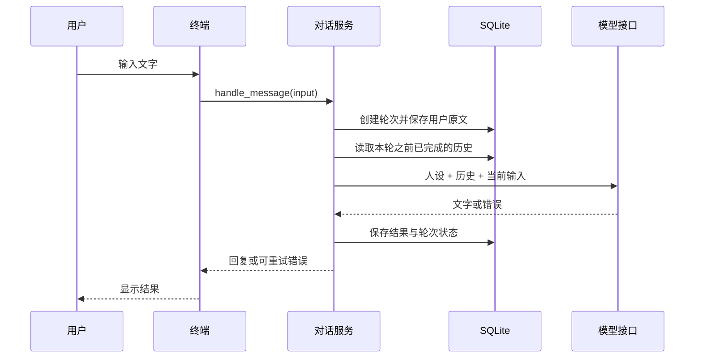

# Mira Companion 第一版对话核心技术设计

版本：0.1（实施设计草案）
日期：2026-11-18
状态：第一版对话闭环已实现；真实模型专项测试已通过

## 1. 目标和范围

本设计细化《虚拟女友核心技术设计》的阶段 1：先做一个独立、可持续运行的单用户、单角色文字对话核心。用户在终端输入文字，程序读取角色配置和近期对话，调用模型生成文字，将输入和回复保存到本地；重启后可以继续聊天。未来 QQ 等通讯方式通过适配层调用同一个核心。

本版实现角色配置、终端交互、模型调用、SQLite 持久化、有限近期上下文、可见的失败状态及手动重试。人设可通过编辑配置文件调整，下一轮生效。显式偏好与纠正、长期记忆、自动摘要、主动联系、角色包导入导出和 QQ 正式接入均是后续阶段；不预设这些功能已经实现。第一版完成不等于 PRD 全部验收完成。

设计参考本地 fish-memory `ab3a80e`、xingxi `94115aa`、xiyuai `06928e2` 的相关源码，属于静态分析，尚未对这些仓库进行端到端实测。数据作用域和接口参考它们的思路，不直接复制其代码。产品边界以 PRD 和现有核心技术设计为准。

## 2. 技术选型

| 项目 | 第一版建议 | 理由与限制 |
| --- | --- | --- |
| 语言 | Python 3.10+ | 与现有经验一致；实际环境和依赖版本在实现时锁定 |
| 服务形态 | 单进程、单机应用 | 满足本地验证；不承诺多进程共享同一库 |
| 本地存储 | SQLite，标准库 `sqlite3` | 保存消息、轮次和角色标识；每次使用参数化 SQL 与事务 |
| 模型 | 配置一个 OpenAI 兼容 Chat Completions 接口 | 模型、base URL、密钥和参数配置注入；供应商及模型待选，先验证其兼容性 |
| 模型客户端 | 标准库 HTTP 客户端调用 OpenAI 兼容接口 | 首版无需额外运行时依赖；不兼容时新增适配实现，不改变业务接口 |
| 交互 | 同步终端，非流式文字 | 便于观察完整轮次；流式、并发通道及打断后续设计 |
| 配置 | JSON 角色文件 + 环境变量 | 使用标准库解析；密钥只从环境或本地 `.env` 读取，不提交仓库 |

以上是实现建议而非已验证的环境。不同兼容服务的参数、错误码和用量字段可能不同；首个服务确定后进行连通和异常测试。模型名称、预算和最终运行目录尚待实际配置，不在文档中填写密钥。

## 3. 目录与依赖方向

以下是第一版实际结构；后续阶段再按职责扩展目录：

```text
mira-companion/
  pyproject.toml              # 项目依赖与命令入口
  .env.example                # 变量名称和非敏感示例
  configs/
    character.example.json    # 可提交的角色示例
  src/mira/
    cli.py                    # 终端输入、命令和输出
    config.py                 # 环境变量解析与启动校验
    models.py                 # 输入、结果和错误类型
    conversation.py           # 对话编排、重试与状态转换
    context.py                # 人设、历史和当前消息组装
    storage.py                # SQLite、迁移与仓储
    provider.py               # 兼容接口适配
  tests/                      # 状态、上下文与失败恢复测试
  docs/
```

建议在本地 `data/` 放数据库、`configs/character.json` 放个人角色配置；这两个位置及 `.env` 必须加入 `.gitignore`。示例角色文件可提交，不含真实聊天和私密信息。备份文件、SQLite 的 `-wal` / `-shm` 文件也不能误提交。生产使用时可通过环境变量显式指定数据与角色配置路径。

依赖方向：CLI 只调用应用服务；应用服务依赖领域结构、仓储和模型接口；CLI 在启动时装配 SQLite、模型供应商和文件配置。领域对象不引用终端、QQ 或某个 SDK 类型。第一版无需创建空的记忆、主动联系或 QQ 模块，等实现相应阶段再新增。

## 4. 一轮对话的时序



1. 终端为每次新输入生成消息 ID，携带固定用户和角色 ID 调用应用服务；空白输入不创建轮次。
2. 应用服务验证输入和角色配置。角色不存在或配置无效时返回明确错误；不静默换成另一角色。
3. 在 SQLite 事务中以 `user_id + character_id + source + source_message_id` 为唯一键，创建 `pending` 轮次并保存原文。提交成功后才调用模型。
4. 查询同用户、同角色**本轮之前且已完成**的最近完整轮次。每个已完成轮次保留用户和助手成对消息，不把失败轮次或当前消息作为正常历史。按时间/序号升序装配，当前输入只追加一次。
5. 从磁盘读取并验证角色文件，按配置选取最近 N 轮和总预算内的上下文；逐轮从最旧开始丢弃，保持 user/assistant 成对。系统设定和当前消息不丢弃；若它们本身超出预算，返回明确错误。计数方式见第 7 节。
6. 将模型请求发给 Provider。模型调用不持有数据库事务；首版不流式、不自动重试，避免超时后产生不可控的重复调用和费用。
7. 收到非空回复后，在一个事务里保存助手消息并将轮次置为 `completed`；失败时将轮次置为 `failed`，保留原始用户消息和脱敏错误类型。保存失败不能伪报成功。
8. 成功返回文字，终端展示。终端展示结果与生成结果分开：首版不宣称外部平台已投递，也不实现平台投递状态机。

## 5. 模块职责与接口

| 模块 | 输入与输出 | 责任边界 |
| --- | --- | --- |
| CLI | 用户输入 → 输出文本/错误 | 生成新消息 ID、解析 `/retry` 等命令，不拼模型 Prompt、不直接写 SQL |
| ConversationService | `handle_message(MessageInput) -> ConversationResult` | 编排持久化、上下文、模型调用和状态转换；不绑定 SDK 或渠道 |
| ContextBuilder | 角色、完整历史、当前输入 → `ModelMessage[]` | 保持顺序与角色成对，避免本轮重复；不负责事实推断 |
| `load_character` | 角色文件 → 角色配置 | 每轮读取并校验；失败显式提示；用户消息不能改写配置 |
| Repository | 轮次/消息的创建、查询和条件更新 | SQLite 的作用域过滤、唯一约束与事务 |
| ModelProvider | `generate(ModelRequest) -> ModelResult` | 翻译模型请求，返回文本、提供方、模型和可选用量；将错误映射为内部错误 |
| CLI 启动 | 配置 → 已装配服务 | 初始化数据库、创建依赖；配置不完整则启动失败 |

逻辑契约草案：

```python
MessageInput(user_id, character_id, source, source_message_id, text, occurred_at)
ConversationResult(turn_id, status, text=None, error_code=None, retryable=False)
ModelRequest(messages, model, timeout_seconds, max_output_tokens, temperature)
ModelResult(text, provider, model, usage=None)
handle_message(message: MessageInput) -> ConversationResult
retry_turn(turn_id: str) -> ConversationResult
```

以上不是最终代码或外部 HTTP API。所有时间使用带时区的 UTC 时间；终端展示可转换本地时间。相同输入 ID 重放时：已完成返回已保存结果；失败返回原轮次状态及重试提示；处理中返回处理中；相同 ID 的内容或作用域不一致返回冲突，不新建轮次。首版只处理本机单进程串行输入；未来并发适配器必须增加按角色/会话排队和持久化抢占，不能误认为现有契约已经提供多进程保证。

## 6. SQLite 数据结构草案

使用整数自增 `sequence` 保证本地顺序，并使用稳定 UUID 或等价 ID 对外引用；SQLite 主键、外键及唯一约束在实现时通过迁移创建。原文与派生内容分开；首版不创建空的长期记忆表。

| 表 | 主要字段 | 约束 |
| --- | --- | --- |
| `characters` | `character_id`, `config_path`, `created_at` | 对应稳定角色身份；设定正文以当前配置文件为准 |
| `turns` | `id`, `sequence`, `user_id`, `character_id`, `source`, `source_message_id`, `status`, `created_at`, `updated_at`, `error_code` | 来源作用域内唯一；状态 `pending / completed / failed` |
| `messages` | `id`, `turn_id`, `role`, `text`, `occurred_at`, `created_at` | `role` 为 `user / assistant`；一个轮次最多各一条；失败轮次没有成功助手消息 |
| `model_calls` | `id`, `turn_id`, `attempt`, `provider`, `model`, `status`, `input_tokens`, `output_tokens`, `error_code`, `created_at` | 保存调用尝试的元数据；用量允许为空，不保存密钥和完整 Prompt |
| `schema_migrations` | `version`, `applied_at` | 启动时按版本执行迁移；不能随意删除用户数据重建 |

用户消息和轮次首次创建同事务；助手消息与 `completed` 状态同事务。`model_calls` 的记录与调用不能构成跨网络原子操作，进程可能在调用后、结果持久化前中断，因此恢复时只标记中断并允许用户决定是否重试，不能声称恰好调用一次。

角色 ID 是数据归属的稳定标识，不能从角色名称推导。角色配置改名或修改表达风格不应改变 ID；如修改配置文件中的 ID，应拒绝悄悄接管已有角色历史。多角色共享、跨平台用户绑定等本版不实现。

## 7. 配置与上下文

角色文件建议包含 `character_id`、`display_name`、性格描述、表达习惯、角色背景和互动边界。角色背景若为虚构，应明确标为角色设定，不写成现实已发生的经历。修改配置不覆盖已保存的原始聊天；配置校验失败时停止本轮并提示修正。

环境配置包括 `MIRA_MODEL_BASE_URL`、`MIRA_MODEL_API_KEY`、`MIRA_MODEL_NAME`、`MIRA_DATABASE_PATH`、`MIRA_CHARACTER_PATH`、请求超时、最大输出 token、近期轮次及输入预算。`.env.example` 只列变量与示例占位值。程序使用标准库读取本地 `.env`；进程环境变量优先，终端启动时说明优先级。

第一版先使用可配置的最近完整轮次上限，并通过保守的字符预算控制输入；字符数不是 token 数，不能用它保证适配所有模型上下文上限。实现时应预留 token 计数策略，记录服务返回的实际 usage；配置时为系统提示、当前输入和最大输出预留余量。若服务返回上下文超限，显示明确错误并允许调整预算重试，不得静默删掉当前消息。

## 8. 异常、重试和恢复

| 场景 | 第一版行为 |
| --- | --- |
| 重复输入 ID | 返回原轮次结果或状态；内容冲突时拒绝 |
| 模型超时、断网、限流、空文本 | 保存失败状态与原文，显示原因；用户决定是否重试 |
| 模型可能已收到请求但本地超时 | 重试可能产生额外模型调用和费用；界面明确提示 |
| 生成成功但数据库保存失败 | 不展示为已保存成功；报告失败。模型返回可能无法恢复，不自动重发 |
| 进程在 pending 时退出 | 启动时将本应用遗留的 pending 标记为中断失败；单进程前提下允许手动重试 |
| 重试失败轮次 | 沿用原轮次与原始用户消息，新建调用尝试；不重复保存用户消息 |
| 用户在失败后又发送新消息 | 允许继续聊天；失败轮次不混入完整历史，仍可查看和重试。重试旧轮次只使用其之前已完成的历史，不把更晚对话倒灌 |
| 角色配置或数据库无法读取 | 启动或本轮明确报错；不删除、不自动重建用户数据 |

为避免旧轮次在已经发生后续聊天时突然插入一条过时回复，首版 `/retry` 只允许重试**当前角色最近一轮且状态为 failed 的轮次**；若已有后续轮次，提示用户作为新消息重新发送。重试采用当前可用的角色和模型配置，界面说明结果可能与当时不同。第一版不实现从任意历史轮次分叉。

## 9. 终端交互草案

```text
mira chat                 # 启动本地对话
/help                     # 帮助
/status                   # 当前角色、模型名称和最近失败状态，不显示密钥
/retry                    # 重试最近的失败轮次
/exit                     # 退出
```

入口名称和参数在实现时确定。终端普通文本才创建对话轮次；命令不作为用户聊天发送给模型。空输入不处理。`Ctrl+C` 或退出期间，如轮次仍 pending，下次启动按第 8 节恢复。日志默认只记录轮次 ID、状态、耗时、错误类型和可选 token 用量，不输出 API Key、完整 Prompt 或聊天正文；数据库仍会保存聊天原文，用户应自行保护本地数据和备份。

## 10. 安全与角色边界

本版角色应明确是虚拟角色，不声称自己是现实中的真人，也不声称完成没有发生的现实行动；不通过责备或威胁迫使用户聊天。基础角色指令写入配置或固定系统约束，用户输入不能覆盖程序对数据作用域、密钥和角色身份的控制。对重大现实危险的响应及未成年人等策略在实际发布前单独设计、测试和本地化；不能把普通提示词当成可靠的危机识别机制。当前本地原型不宣称已具备完整安全保障。

## 11. 开发顺序与验收

1. 建立 Python 工程、配置示例、忽略规则和数据库迁移；确认使用的模型服务及连接。
2. 完成 SQLite 仓储与原子轮次保存，验证用户消息、回复与状态。
3. 完成角色加载、上下文组装和 Provider；使用假模型验证顺序、当前消息只出现一次、完整轮次截取与异常映射。
4. 完成 ConversationService 和 CLI，跑通多轮、重启及失败重试。
5. 通过真实模型做一次端到端试聊，记录模型标识、耗时、可获得的用量和角色表现；不将自然度预设为已达标。

验收覆盖：配置无效；多轮及重启；超预算；重复 ID 与冲突；模型超时/空回复；失败轮次重试和旧轮次禁止重试；调用中进程退出；保存结果失败；角色配置修改；私密数据不进入 Git。自动测试用临时数据库和假 Provider，不依赖真实密钥；真实模型测试单独记录，不把网络故障等同业务逻辑失败。

## 12. 后续扩展与待决事项

2026-11-27 进度说明：本文保留首版对话切片的设计背景。用户偏好、长期记忆首版、待跟进、主动决策、AstrBot 插件及独立 QQ 服务已陆续接入；本机管理端、原始对话、运行日志和快捷启动已添加。最新阶段状态以《虚拟女友核心技术设计》及《记忆模块建设计划》为准；完整角色资料迁移和真实平台连续验收尚待完成。

阶段 2 增加独立的用户偏好与纠正；阶段 3 增加带来源和状态的记忆候选、按需召回、删除及防复现；后续依次增加跟进、主动决策、角色包和 QQ 适配。长期记忆的关键词、向量或混合召回先用同一场景集对照；自然淡化、联系强化与情绪/虚构日常等机制需根据体验实验决定，不作为首版前置条件。

待实现前确定：具体模型服务和模型名、可接受预算、数据备份位置，以及角色初始设定。OpenAI 兼容只是协议假设，服务验证不通过时调整 Provider；这些选择不改变通道独立、保存原文和可恢复的设计原则。
