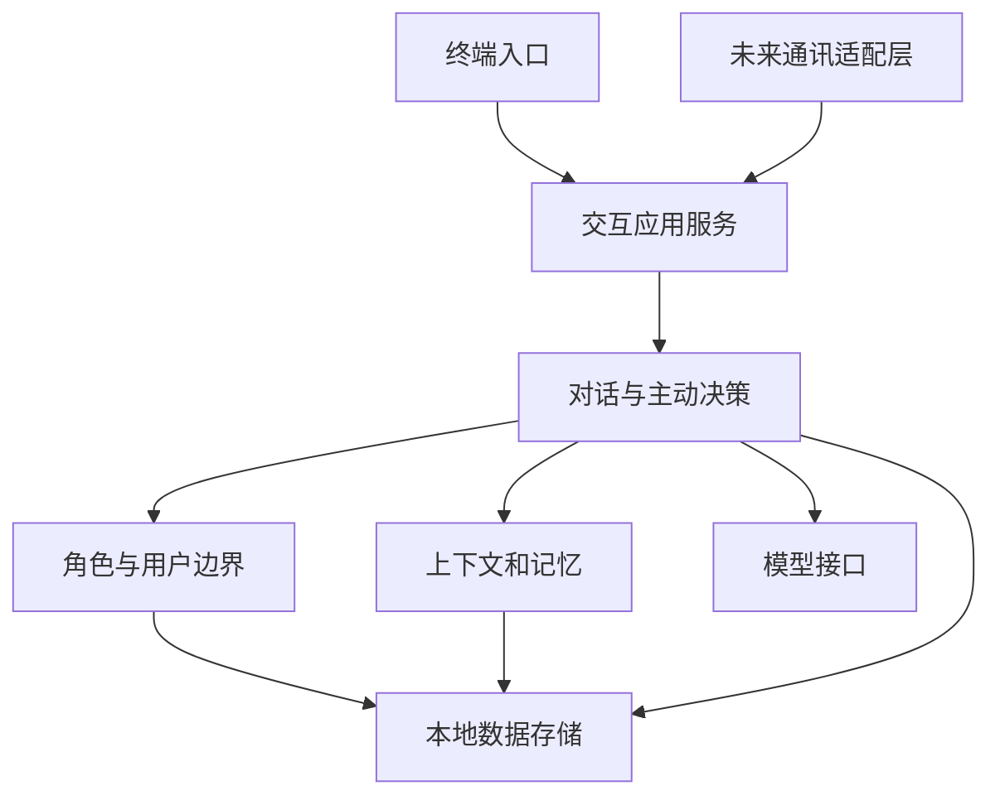

# 虚拟女友核心技术设计与实施计划

版本：0.7
日期：2026-11-19
状态：独立文字对话核心已实现；用户偏好、明确纠正及主动联系暂停状态已部分实现

## 1. 目标与依据

构建单用户、单角色、文字交互的虚拟陪伴核心。输入用户文字，结合角色设定、近期对话和有依据的记忆生成文字；未来由独立通讯适配层接收平台消息并投递输出。主动联系由核心判断是否值得联系并形成待投递文字；平台能力与实际投递由外层负责。

依据现有《虚拟陪伴产品需求说明书 v1.6》和《拟真记忆系统设计》。PRD 将 QQ 单角色真实使用作为第一阶段验收；按当前决策，开发先验证独立核心，随后再接回 QQ 完成该项验收。AstrBot 已验证模型回复与一次定时触发投递，跨天和平台限制仍待实测；这不等于主动联系决策已完成。

第一阶段最终范围：角色设定与调整、近期上下文、私有记忆及纠错删除、待跟进与受控主动联系、单角色完整资料导出及新环境恢复。先以本地终端验证；不要求管理界面。多角色共享、微信、语音及形象延后；数据保留稳定角色 ID，并不提前实现多角色。

## 2. 分层与职责

| 部分 | 职责 | 主要边界 |
| --- | --- | --- |
| 终端 / 未来适配层 | 输入文本、显示结果；未来负责平台标识映射与投递反馈 | 不负责角色和记忆决策 |
| 交互应用服务 | 创建交互、组织流程、提供统一输入输出 | 不绑定 QQ 或 AstrBot 对象 |
| 角色与偏好 | 加载人设、互动习惯、明确边界与主动设置 | 用户明确边界优先于人设倾向 |
| 上下文与记忆 | 原文、近期对话、摘要、记忆及跟进的读取和更新 | 保持来源及角色归属；明确区分候选和事实 |
| 对话与主动决策 | 组装上下文、决定回复；主动场景判断是否联系 | 每个逻辑步骤不预设独立模型或 Agent |
| 模型接口 | 调用配置的模型并返回结果、错误和用量 | 屏蔽具体提供方；密钥留在部署配置 |
| 本地存储 | 持久化权威数据、事务与恢复 | 检索索引和摘要是可重建的派生数据 |

当前已采用 Python 单进程、SQLite 权威存储、可配置的 OpenAI 兼容模型接口和终端入口。QQ 后续选 AstrBot 插件还是独立适配待接口和实测确定。

## 3. 普通对话生命周期

1. 接收规范化输入，校验用户、角色、消息 ID 与时间；同一来源重复 ID 幂等，保留用户原文。
2. 支持有限时间窗口合并短消息并设置最大等待时长；首个终端版本可一次输入视为一轮。合并不覆盖原消息。
3. 同角色消息按顺序处理。先持久化输入；生成期间的新输入暂进入下一轮，后续再评估打断。
4. 加载角色设定、用户明确边界、近期原文和有效会话状态；按权限和相关性召回已确认、有效的记忆，较早对话可用有来源的摘要。
5. 理解当前表达，处理明确偏好、纠正、暂停和忘记等高优先级请求；涉及歧义或大范围删除先确认范围。高优先级规则生效后再生成下一次回复。
6. 组织提示内容，模型生成符合角色和场景的文字；基础校验非空与格式，必要时标注失败。理解、决策与生成在首版可合并调用，拆分须以质量或可观测性为依据。
7. 保存生成结果并返回文本。终端展示成功与模型生成成功分开；后续适配层报告投递状态，结果不确定时不盲目重发。
8. 普通记忆候选与摘要可异步整理；必须立即生效的边界、明确暂停、纠正和删除先完成或明确失败，再允许后续轮次读取旧状态。

上下文优先级建议：用户的明确边界与当前新纠正、当前输入、近期对话、相关有效记忆、较早摘要；角色人设约束表达风格。权限和安全边界不能被一般人设覆盖。输出预算、上下文长度、聚合时间和模型参数均通过真实使用测定。

## 4. 核心数据与接口草案

字段为逻辑契约，不代表最终数据库结构或固定 JSON。时间同时保存事件发生时间及写入时间，使用带时区时间戳；来源消息和事件可追踪。

| 对象 | 关键字段 | 说明 |
| --- | --- | --- |
| Character | character_id、设定版本、人设、互动习惯 | 固定身份；修改从后续交互生效 |
| UserPreference | user_id、character_id、规则、状态、来源、版本 | 显式偏好和边界直接生效，不依赖语义召回 |
| Message / Turn | message_id、turn_id、角色、用户、原文、发生时间、状态 | 多消息可组成一轮；原文保留 |
| Response | response_id、turn_id、文本、生成状态、投递状态 | 生成、交付、失败及未知结果分开 |
| Memory | memory_id、类型、内容、角色、来源、有效期、置信与版本、状态 | 候选、已确认、争议、已替代、已删除等状态需可区分 |
| FollowUp | 事项、来源、时间窗口、状态、角色 | 完成、取消、过期或已处理后不反复触发 |
| ProactiveSettings | 用户、角色、授权模式、安静时段、每日上限、未回复处理 | 默认关闭；明确暂停另存为有期限的硬边界 |
| ProactiveDecision | 机会 ID、候选来源、判断时间、发送或跳过、原因、规则版本 | 同一机会只决策一次，记录模型与硬边界的判断结果 |
| Delivery | 决策 ID、目标入口、投递状态、平台回执、更新时间 | 生成成功不代表 QQ 已送达；未知结果不自动重发 |

初始接口约定：`handle_message(input) -> response`；`evaluate_proactive(user_id, character_id, opportunity_id, now) -> decision`；`report_delivery(decision_id, outcome)`；以及记忆的候选、确认、召回、纠错和删除。具体参数、事务与异常在实现前确定。适配层将平台身份映射为用户、角色与会话；主动结果包含目标标识、文字、过期时间和投递标识，不把平台凭据写入核心领域对象。

## 5. 记忆与数据控制

普通原文、近期上下文、摘要、长期记忆和待跟进分开。用户明确或反复确认的内容可成为事实；玩笑、推测、角色虚构内容和未经确认的敏感信息不能直接变成用户事实。候选与来源关联；不确定的冲突待确认，不能靠相似度直接覆盖。事实更新保留必要历史；当前事实与过去状态区分。

召回先按用户、角色和有效性过滤，再做结构化 / 全文检索与排序；选择少量与当前话题相关、有来源的结果。首版候选 SQLite 结构化查询或全文检索，具体中文检索效果需测试；向量检索、联系强化和自然淡化作为对照实验，不能削弱明确边界。查询命中不等于实际在回复中使用。

删除按用户选择的范围处理原文、记忆、摘要、索引、缓存与跟进；如果保留原文，需来源级阻止旧内容再次被提取。删除和纠正之后以版本或删除标记阻断在途异步任务写回旧数据，待派生数据清理或重建完成才能重新启用；失败要可见并可重试。用户重新提及是否允许再学习尚待定，默认不从旧来源自动复活。

## 6. 主动联系

### 6.1 触发机会与授权

模型不会自行在后台运行。聊天进程内的定时检查只产生“是否值得联系”的判断机会，不直接发送消息；退出聊天后检查停止。当前本地实现覆盖两类机会：已记录且仍有效的待跟进事项到达合适窗口；用户开启主动联系后，在允许的时段做低频日常检查。用户也可只允许约定事项，这是后续设置。主动联系默认关闭，未获授权时不调用模型生成主动内容。当前实现按本地 09:00–22:00 的三个窗口检查，近六小时有用户对话、上一条主动消息未获回复或当天已投递一条时跳过；这些初始数值需通过试用调整，不把“每天发一条”当目标。

待跟进事项已有用户原话来源、最早联系时间、有效期、状态和角色归属。用户取消计划或已经说出结果时，模型可关闭事项；要求忘记和不再谈论时与长期记忆删除联动尚待实现。普通闲聊、玩笑、角色编造的经历不能生成可发送的跟进理由。已用临时数据库和合成事项验证本地主动链路，不把测试事项写入真实用户资料。

### 6.2 一次机会的判断流程

1. **固定规则预检。** 核对用户授权模式、当前暂停、安静时段、每日上限、未回复退避、候选有效期、是否已处理及入口绑定。任一条件不满足，记录跳过原因，不调用生成模型。现有 `is_contact_paused` 用于暂停检查，但当前尚未接入主动发送流程。
2. **模型判断。** 向模型提供角色设定与互动习惯、当前时间、候选的可信来源和状态、近期对话及最近主动联系的结果。要求模型在“跳过”和“提出一条待发送文字”之间选择，并给出简短原因。角色性格决定关心重点、语气和是否倾向联系；模型不能自行放宽授权、暂停或频控。没有具体线索的日常问候只在用户允许时提出，不编造共同经历或现实行动。
3. **内容校验。** 拒绝空文本、超长内容、与已失效事项关联的内容，以及明显重复的催促；模型结果格式错误或超时则跳过并记录错误。模型提出文字仍只是草案。
4. **发送前复核。** 再读取最新授权、暂停、安静时段、频控、候选状态和入口可用性。用户在模型生成期间说“别找我”或取消事项时，草案立即作废。通过本地事务为本次机会原子预留投递名额，并设置稳定的机会 ID 和投递 ID，防止调度器重跑或并发检查突破每日上限。
5. **平台投递与回执。** 适配层只接收已批准的草案、目标会话及投递 ID，调用 QQ 后回报成功、明确失败或未知。生成成功与 QQ 客户端可见分别记录；未知结果先核对，不盲目重试。用户未回复时收敛后续联系，不能连续追问。

### 6.3 状态、恢复与最小实现顺序

每次机会记录来源、判断时间、跳过或提出草案的原因；投递另记待发、已发送、被拒绝、结果未知或过期。模型草案不计作已联系；待发名额和结果未知的投递暂占每日上限，明确失败后可释放，避免并发或未知回执时超发。进程重启后，过期的日常机会直接作废；未过期的待跟进事项可在下次允许的窗口重新评估，或等用户主动聊天时自然提起。暂停结束或用户恢复后只评估新机会，不补发积压内容。

先在本地用可控时钟、合成跟进事项和假投递器验证发送与跳过，再接真实的事项提取与模型决策，最后通过独立适配层接 QQ。第一轮真实 QQ 验证要覆盖跨天投递、权限关闭、断线恢复、重复触发和客户端可见性；AstrBot 已验证的一次定时投递只能证明当时的通道能力。QQ 适配选 AstrBot 插件还是独立进程，待这条接口和平台测试结果确定。

## 7. 一致性、异常与安全

| 场景 | 设计要求 |
| --- | --- |
| 重复输入或重放 | 使用稳定来源 ID 去重；无来源 ID 的终端输入生成本地 ID；记忆候选按来源与类型保证幂等 |
| 同角色并发 | 按角色 / 会话顺序处理，防止偏好更新与回复交错；不同角色隔离为后续扩展约束 |
| 模型超时、空回复、进程崩溃 | 原始用户消息已保存；记录失败，允许安全重试；不将失败回复视为完成 |
| 发送未知 | 核心记录未知并交由适配层核对，不自动重复发送 |
| 偏好更新、删除与异步任务竞争 | 版本检查或删除标记阻止旧任务覆盖；派生索引失效并重建 |
| 敏感数据 | 本地默认保存必要信息；日志不默认打印密钥和完整私人对话；导出前提示隐私 |

角色不假称真人或现实中已完成的行动；不得用责备、内疚或威胁迫使用户继续交流。涉及重大现实决定或紧急危险时保持关心、不假装专业资格。具体响应策略在测试用例中细化。

## 8. 导出与恢复

完整包包括角色设定、互动偏好和边界、已确认记忆及来源、共同经历、跟进、按序聊天、主动设置和版本清单；模板包仅包含无私人聊天和经历的角色设定。排除 QQ 和模型密钥、访问令牌与环境配置。导入先校验版本、完整性和缺项，在临时区域准备并验证，成功后整体提交；失败不得留下半个角色。派生索引重新生成，外部入口在新环境重新绑定。首阶段只验单角色新环境恢复。

## 9. 验证方法与验收

每阶段保留输入、关键状态、输出、结果和错误原因，敏感数据最小化。固定场景加真实连续试用；暂不虚构量化阈值。

| 场景 | 通过表现 |
| --- | --- |
| 基础多轮与重启 | 原文和角色身份保留；重启后能承接近期话题 |
| 短消息、重复事件、模型失败 | 不丢原文、不重复处理；失败可见、不会重复刷屏 |
| 称呼修改与立即纠正 | 下一轮遵守新偏好，旧错误不再作为当前事实 |
| 记忆误提取与删除 | 不将推测当事实；删除后不能从摘要、索引、在途任务复现 |
| 面试跟进 | 事项取消或已聊过结果时跳过；授权关闭和安静时段不产生待投递消息 |
| 未回复及恢复 | 主动联系收敛，不集中补发过期内容；失败或未知可追踪 |
| 完整导出与新环境导入 | 保留角色、历史、偏好、记忆及有效事项；不包含密钥；损坏包不产生半成品 |
| 后续真实 QQ | 单独验证跨天主动投递、权限关闭、断线恢复和客户端可见性；本地模拟不替代 |

体验另外评估人设一致、回应自然、记忆准确与相关、主动联系时机；对比“近期上下文 + 人设”和“增加长期记忆”等方案，保持相近预算。分别记录误记、漏记、无关回忆、错误纠正失败及成本，不能只看检索命中。

## 10. 阶段计划

| 阶段 | 内容 | 完成标志 | 当前进度 |
| --- | --- | --- | --- |
| 0 设计与评审 | 评审本方案，明确首版模型配置、数据目录和接口选择 | 本体边界、实现顺序和待决项清楚 | 方案已形成；模型选型和部分待决项继续验证 |
| 1 对话闭环 | 终端输入、角色配置、模型调用、原始对话保存和近期上下文 | 可多轮交流，重启后接续；异常消息不丢 | 已实现；本地测试和真实模型专项测试通过，后者覆盖历史工具调用、偏好保存与撤销 |
| 2 用户边界 | 昵称与偏好、暂停和明确纠正的立即生效 | 新一轮执行新规则；可查看状态 | 称呼、回复方式、不聊话题、明确更正及查看撤销已实现；明确暂停与恢复状态可持久化、到期和查看，主动发送前的实际阻断待阶段 4 验收 |
| 3 记忆与跟进 | 候选、确认、召回、更新、纠错删除；待跟进状态 | 跨天相关召回及删除防复现用例通过 | 有来源的待跟进事项及取消、结果关闭已实现；长期记忆及删除联动待做 |
| 4 主动决策 | 机会触发、硬边界、模型选择发送或跳过、生成和投递记录 | 模拟时钟验证发送及不发送；无积压补发 | 聊天进程内的日常与到期待跟进检查、授权和暂停阻断、模型选择及终端投递已实现；QQ 投递待做 |
| 5 迁移恢复 | 完整包 / 模板包导出、校验、原子导入和索引重建 | 新环境恢复，损坏包不污染已有数据 | 待开始 |
| 6 通讯和持续试用 | 选定适配方式接回 QQ，测试实际投递与恢复 | 完成 PRD 中的真实 QQ 条件验收 | 待开始；已有初步 QQ 收发与定时投递验证 |

阶段顺序为建议，阶段 1 是开发的第一个切片；产品第一阶段完成须覆盖后续记忆、主动联系、迁移和真实平台验收。

## 11. 待决事项

1. 首版使用的模型提供方式、模型及预算；以配置注入，不在文档记录密钥。
2. 本体数据的本地目录、备份与保留策略；数据库选型为建议，实施前核对。
3. 哪些明确事实可直接入长期记忆、哪些需要确认；敏感内容默认规则需细化。
4. 用户删除后再次主动提及时的再学习授权语义。
5. 短消息合并窗口、上下文与摘要预算、记忆提取频率、主动联系退避策略：通过真实数据测定。
6. 角色是否有虚构日常及状态演化；先不设计不可解释的亲密度数值。
7. 最终 QQ 适配方式、平台发送条件及跨天有效性；本次实测不代表无限制。

## 12. 版本记录

| 版本 | 内容 |
| --- | --- |
| 0.1 | 记录核心独立、完整对话与记忆生命周期、主动决策、迁移、验收和分阶段计划；尚未实现。 |
| 0.2 | 同步独立文字对话核心与偏好工具的实际进度，记录真实模型专项测试通过；QQ 及完整产品验收仍待推进。 |
| 0.3 | 记录明确主动联系暂停与恢复状态的首版实现及发送决策阶段的待验收项。 |
| 0.4 | 细化主动联系的触发机会、模型选择、发送前复核、投递状态与分步验证。 |
| 0.5 | 同步本地日常主动联系闭环的实现进度与默认检查规则，保留待跟进和 QQ 投递待办。 |
| 0.6 | 定时检查并入聊天进程，开启后无需单独启动终端任务。 |
| 0.7 | 增加聊天内的主动联系预览和手动检查，便于立即验证模型决定与正式边界。 |
| 0.8 | 增加有用户原话来源的待跟进事项、取消和结果关闭，并优先用于到期后的本地主动检查。 |
